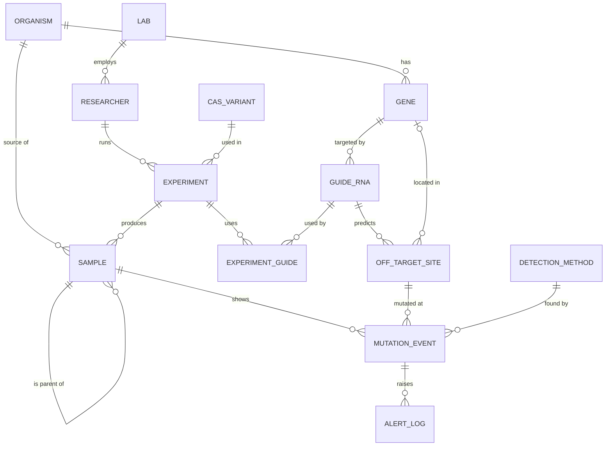

# Genetic Lineage & CRISPR Off-Target Mutation Tracker

## 1. Problem statement (say this in 20 seconds)
CRISPR-Cas9 edits DNA using a guide RNA, but the guide sometimes cuts at *wrong* places (**off-target sites**). Labs grow edited cells into **families of cell lines** (parent → child → grandchild). This database records which guide hit which wrong site, in which cell line, how often, and how mutations travel down the cell-line family tree.

**What makes it different:** the `sample` table references itself (parent_sample_id), so we use a **recursive CTE** to walk the family tree and see inherited mutations.

## 2. ER diagram

| Relationship | Type | How implemented |
|---|---|---|
| Experiment – Guide RNA | M:N | bridge table `experiment_guide` |
| Sample – Sample (parent/child) | 1:N recursive | self-referencing FK |
| Sample – Off-target site | M:N | resolved by `mutation_event` (it also carries attributes: freq, type, date) |
| Off-target site – Gene | N:1, optional | nullable FK (intergenic sites have no gene) |

## 3. Normalization

**Unnormalized table** (one big sheet a lab might keep):

`event_id, sample_code, parent_sample_code, cell_line, experiment_title, researcher_name, researcher_email, lab_name, lab_dept, cas_variant, pam_motif, fidelity, guide_name, guide_seq, target_gene, hit_gene, gene_type, chromosome, position, mismatch_count, region_type, mutation_type, allele_freq, method_name, detected_on`

Problems (anomalies): lab name repeated in every row (update anomaly), deleting the last event of a guide loses the guide (deletion anomaly), can't add a new Cas variant without an event (insertion anomaly).

**1NF** – atomic values, no repeating groups. An experiment uses *several* guides, so "guide1, guide2" in one cell is broken out into rows → `experiment_guide`.

**2NF** – remove partial dependencies. In the key (experiment, guide), `guide_seq` depends only on `guide`, so it moves to `guide_rna`.

**3NF** – remove transitive dependencies:

| Transitive dependency | Fixed by |
|---|---|
| researcher → lab → lab_dept | `lab`, `researcher` |
| experiment → cas_variant → pam_motif, fidelity | `cas_variant` |
| site → gene → gene_type, chromosome | `gene` |
| event → method → is_genome_wide | `detection_method` |
| sample → organism → scientific_name | `organism` |

Result: 13 tables, each fact stored once, all in 3NF.

**Design choice worth mentioning:** `generation` in `sample` is technically derivable from the parent chain (a derived attribute). We store it for speed and keep it correct with a trigger (`trg_sample_generation`).

## 4. Concepts covered (checklist for your report)

| Concept | Where |
|---|---|
| DDL, PK, FK, UNIQUE, CHECK, DEFAULT, ENUM | Part 1 |
| Indexes | end of Part 1 |
| Triggers (BEFORE / AFTER) | `trg_sample_generation`, `trg_high_freq_alert` |
| User-defined function | `fn_risk_level` |
| Views (incl. view on a view) | `v_offtarget_report`, `v_high_risk_events`, `v_experiment_summary` |
| Stored procedure | `sp_experiment_report` |
| INNER / LEFT / SELF joins | Q1–Q4 |
| GROUP BY, HAVING, ROLLUP | Q5–Q9 |
| Scalar / IN / correlated / NOT EXISTS subqueries | Q10–Q14 |
| Recursive CTE (lineage) | Q15–Q18 |
| Window function RANK() | Q19 |
| Transaction, SAVEPOINT, ROLLBACK | Part G |
| ALTER / UPDATE / DELETE | Part H |

## 5. Likely viva questions

1. **What is an off-target mutation?** An unintended edit at a DNA site that looks similar to the intended target.
2. **Why a self-referencing table?** A cell line's parent is also a cell line; the same entity type, so one table with a FK to itself.
3. **Why is `mutation_event` a separate table?** Sample and off-target site are M:N, and the relationship has its own attributes (frequency, type, date).
4. **Why is `gene_id` nullable in `off_target_site`?** Intergenic sites don't fall inside any gene.
5. **Difference between a view and a table?** A view stores a query, not data; it always shows current data.
6. **Why use a trigger for alerts?** So a high-frequency mutation is flagged automatically, without relying on the user to check.
7. **What does the recursive CTE do?** It starts from root samples and repeatedly joins children until no more are found.
8. **Which normal form is this in, and why?** 3NF; no partial or transitive dependencies (see section 3).

## 6. How to run
Open MySQL Workbench (8.0+), open `crispr_tracker.sql`, and run it all (the lightning-bolt icon). Run queries one by one for screenshots. Window functions and recursive CTEs need **MySQL 8**.
